<div align="center">

# 🎓 ConsultWise
### University Faculty-Student Consultation & Appointment Scheduling System

[](https://flutter.dev/)
[](https://dart.dev/)
[](https://firebase.google.com/)
[](https://firebase.google.com/docs/firestore)
[](https://pub.dev/packages/provider)
[](#)
[](LICENSE)
[](#)

**ConsultWise** is an intelligent, reactive cross-platform mobile application engineered using Flutter and Google Firebase to eliminate academic consultation bottlenecks, prevent double-booking collisions, provide real-time faculty availability visibility, and automate appointment management between university students and professors.

</div>

---

## 📌 Table of Contents

- [🎯 Problem Statement & Motivation](#-problem-statement--motivation)
- [✨ Core System Features](#-core-system-features)
  - [I. Authentication & Role-Based Access Control (RBAC)](#i-authentication--role-based-access-control-rbac)
  - [II. Real-Time Teacher Directory & Search](#ii-real-time-teacher-directory--search)
  - [III. Faculty Profile & Credentials Inspection](#iii-faculty-profile--credentials-inspection)
  - [IV. Faculty Weekly Availability Configurator](#iv-faculty-weekly-availability-configurator)
  - [V. Collision-Free Appointment Booking Engine](#v-collision-free-appointment-booking-engine)
  - [VI. Student Consultation History & Status Tracker](#vi-student-consultation-history--status-tracker)
  - [VII. Teacher Request Triage Portal](#vii-teacher-request-triage-portal)
  - [VIII. Real-Time Push Notification Subsystem](#viii-real-time-push-notification-subsystem)
- [📸 Screenshots](#-screenshots)
- [📊 System Documentation & Academic Analyses](#-system-documentation--academic-analyses)
  - [1. Feature Comparison Across Existing Solutions](#1-feature-comparison-across-existing-solutions)
  - [2. Gap Analysis and Solutions Matrix](#2-gap-analysis-and-solutions-matrix)
  - [3. Technology Stack Justification](#3-technology-stack-justification)
- [🏗️ System Architecture & Design Patterns](#️-system-architecture--design-patterns)
  - [5-Tier Layered Architecture Diagram](#5-tier-layered-architecture-diagram)
  - [Annotated Project Directory Tree](#annotated-project-directory-tree)
- [💾 Database Schema & Normalization](#-database-schema--normalization)
- [👥 Team Structure & Roles](#-team-structure--roles)
  - [Workload Allocation Matrix](#workload-allocation-matrix)
- [🚀 Installation & Setup Guide](#-installation--setup-guide)
  - [Prerequisites](#prerequisites)
  - [Step-by-Step Installation](#step-by-step-installation)
  - [Firebase Configuration](#firebase-configuration)
- [🧪 Quality Assurance & Testing](#-quality-assurance--testing)
- [🔮 Future Scope & Roadmap](#-future-scope--roadmap)
- [📄 License & Institutional Context](#-license--institutional-context)

---

## 🎯 Problem Statement & Motivation

In modern engineering universities—such as **Rajshahi University of Engineering & Technology (RUET)**—individual academic advising and thesis supervision are foundational to student academic achievement. However, coordinating one-on-one consultation sessions between faculty members and students currently relies on outdated, manual channels.

Students routinely wander down faculty corridors, knocking on doors during active lectures, research work, or grading hours. Alternatively, they exchange disjointed emails that quickly get lost in overloaded university inboxes. This creates severe logistical bottlenecks:

```
┌────────────────────────────────────────────────────────────────────────────────────────┐
│                         THE CAMPUS CONSULTATION BOTTLENECK                             │
│                                                                                        │
│ Office Drop-In ──► Unplanned Knock / Busy ──► Disjointed Email Threads ──► Missed Deadlines │
│       ▲                                                                        │       │
│       └───────────── Double-Booking Collisions (Wasted Academic Hours) ◄───────┘       │
└────────────────────────────────────────────────────────────────────────────────────────┘
```

Existing alternatives fail to solve this problem:
- **Commercial Schedulers (Calendly, Acuity)**: Expensive per-seat monthly subscriptions, lack university role hierarchies (roll numbers, series, departments), and lack faculty triage mechanisms.
- **Enterprise Calendars (Google Calendar)**: Allow direct calendar insertion without faculty review, causing schedule overrides and requiring paid Google Workspace tiers.
- **Legacy University ERPs**: Built solely for desktop web browsers, complex navigation, and completely absent of real-time mobile push alerting.

**ConsultWise** bridges this void by delivering a dedicated, zero-cost, reactive mobile platform aligned with **United Nations Sustainable Development Goal 4 (Quality Education, Target 4.3 & 4.4)**.

---

## ✨ Core System Features

### I. Authentication & Role-Based Access Control (RBAC)
- 🔑 **Dual-Role Onboarding**: Seamless registration tailored for both **Students** and **Teachers**.
- 🎓 **University Metadata Ingestion**: Captures student **Roll Number**, **Admission Series**, and **Academic Department** upon registration for instant faculty identification.
- 🔒 **Cryptographic Session Security**: Managed authentication via Firebase Auth with token-based session persistence.
- 📲 **Automated Device Token Capture**: Automatically links hardware **FCM device tokens** to user profiles in Cloud Firestore for targeted push notifications.

### II. Real-Time Teacher Directory & Search
- 🔎 **Multi-Attribute Keystroke Search**: Instant, sub-second client-side filtering across faculty **Name**, **Department** (CSE, EEE, ME, etc.), and **Academic Rank**.
- 🗂️ **Zero Server Round-Trips**: In-memory regex filtering via `TeacherProvider` ensures instantaneous search results without consuming database read quotas.
- 🏷️ **Categorized Faculty Cards**: Clean Material 3 cards displaying professor credentials, designations, and departmental affiliations.

### III. Faculty Profile & Credentials Inspection
- 👤 **Dedicated Teacher Profiles**: Comprehensive profile view presenting academic designation, departmental affiliation, official university email, and consultation availability indicators.
- 📅 **Direct Booking Action**: Instant one-tap navigation to the interactive appointment booking screen.

### IV. Faculty Weekly Availability Configurator
- 🗓️ **7-Day Schedule Drawer**: Faculty members can define consultation office hours for any day of the week (Monday through Sunday).
- ⏰ **Interactive Material TimePickers**: Easily select precise start and end times for each day.
- 💾 **Structured Subcollection Storage**: Availability persisted under `teachers/{id}/availability`, allowing flexible per-day scheduling.

### V. Collision-Free Appointment Booking Engine
- 🛑 **Deterministic Concurrency Validation**: Before committing any appointment, the algorithm executes a pre-booking verification query against Cloud Firestore for the selected teacher, date, and time.
- 🚫 **Zero Double-Booking Guarantee**: If another student has already scheduled that slot, the transaction aborts with an intuitive alert: *"This time slot is already booked. Please choose another time."*
- 📋 **Lifecycle Tracking**: New appointments are committed with an initial `Pending` status and timestamped metadata.

### VI. Student Consultation History & Status Tracker
- 📊 **Real-Time Appointment Tracker**: Displays all upcoming, past, and evaluated appointments booked by the student.
- 🎨 **Color-Coded Status Badges**:
  - 🟡 **Pending**: Request submitted and awaiting faculty triage.
  - 🟢 **Approved**: Confirmed by faculty; slot locked.
  - 🔴 **Rejected**: Declined by faculty (e.g., faculty meeting conflict).
  - ⚪ **Completed**: Consultation successfully finished.
- 🔄 **Real-Time Synchronous Updates**: Automatically updates via Cloud Firestore listeners without manual pull-to-refresh.

### VII. Teacher Request Triage Portal
- 📥 **Incoming Appointment Queue**: Faculty dashboard showing all pending consultation requests with student identity, roll number, and department.
- ✅ **One-Tap Actions**: Approve or Reject consultation requests in a single tap, updating Firestore state instantly.
- 📈 **Daily Schedule Overview**: Quick summary of today's upcoming meetings to organize office hours.

### VIII. Real-Time Push Notification Subsystem
- 🔔 **FCM Push Notification Engine**: Dispatches push alerts to student devices when their appointment is approved or rejected, and alerts faculty upon new submissions.
- ⚙️ **Background Message Handler**: Standalone background daemon registered via `@pragma('vm:entry-point')` handling notifications when the application is terminated.
- 📢 **High-Importance Android Channel**: Configured with `appointment_notifications` channel to deliver immediate heads-up banners on Android devices.

---

## 📸 Screenshots

| Student Workflow | Teacher Workflow | Description |
|:---:|:---:|---|
| 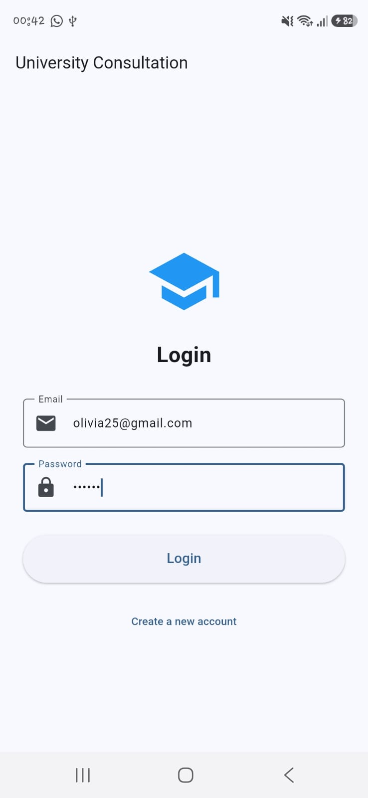 | 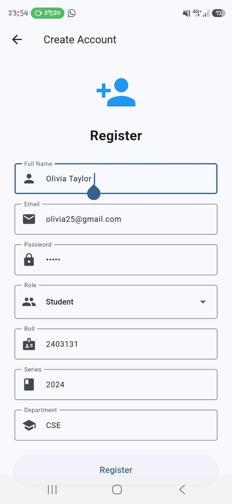 | **Authentication & Dual-Role Registration** (`login_screen.dart`, `register_screen.dart`) — Role-based onboarding supporting Student and Teacher accounts with institutional metadata (Roll, Series, Department). |
| 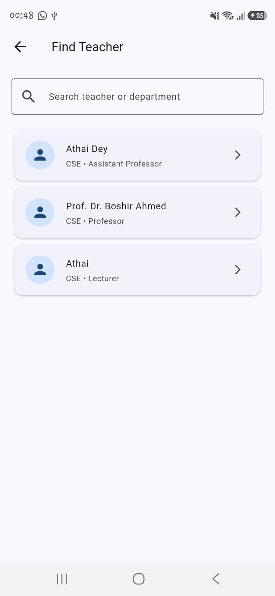 | 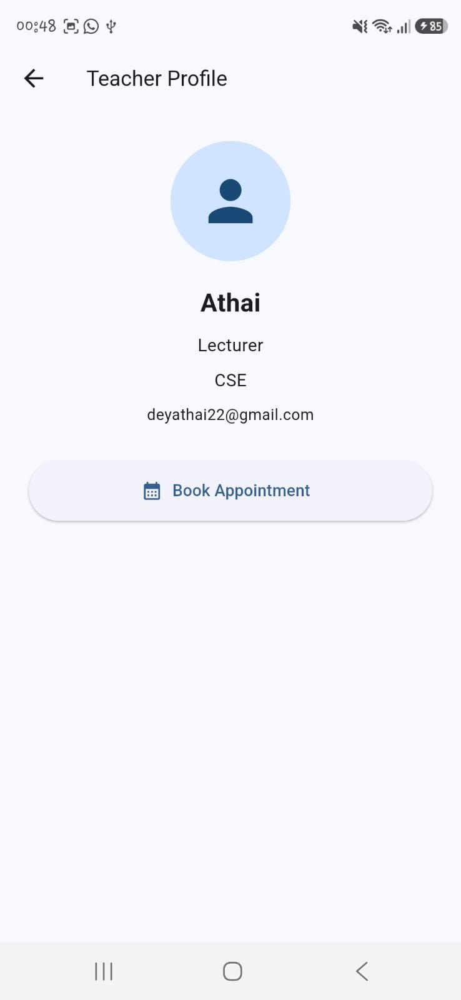 | **Faculty Directory Search & Profile Inspection** (`teacher_search.dart`, `teacher_profile.dart`) — Instantaneous multi-parameter filtering by faculty name, engineering department, and academic rank. |
| 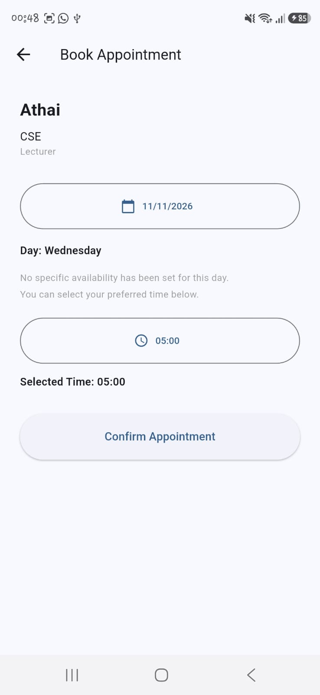 | 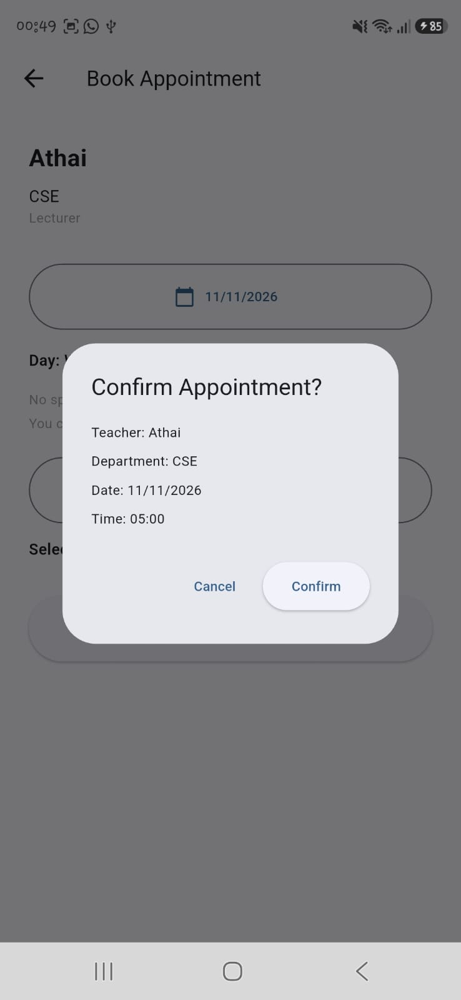 | **Slot Selection & Booking Confirmation** (`book_appointment.dart`) — Interactive date selection and time picker with real-time faculty availability checks and modal confirmation dialog. |
| 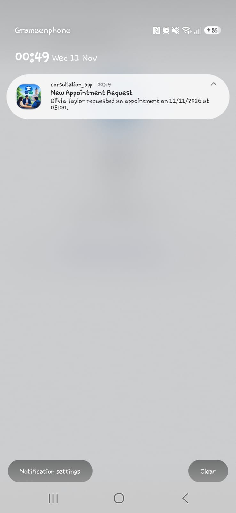 | 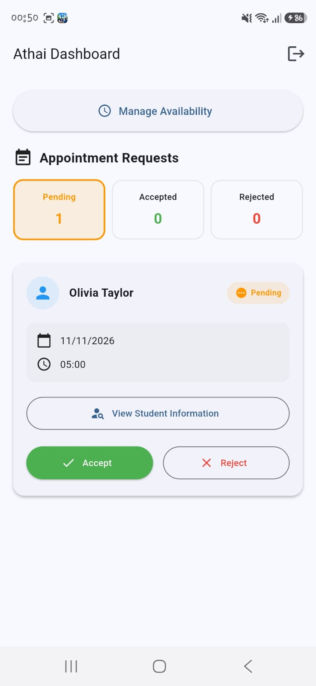 | **Instant Push Alert & Teacher Request Triage Hub** (`teacher_home.dart`) — Automated FCM notification delivering incoming request alerts; faculty portal with one-tap Accept / Reject triage actions. |
| 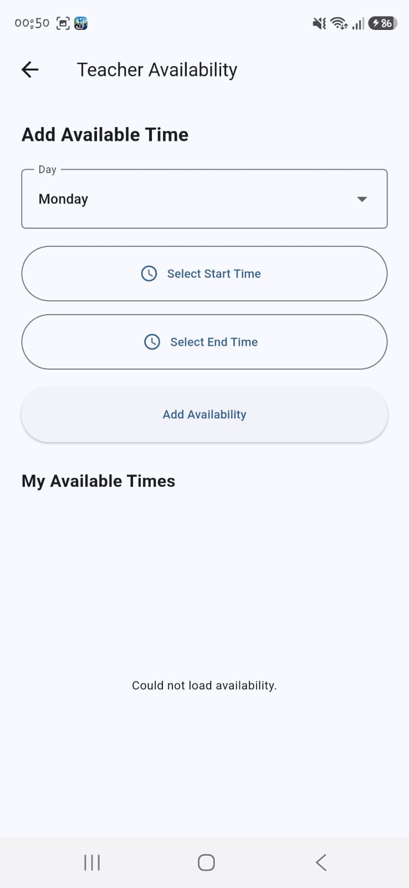 | 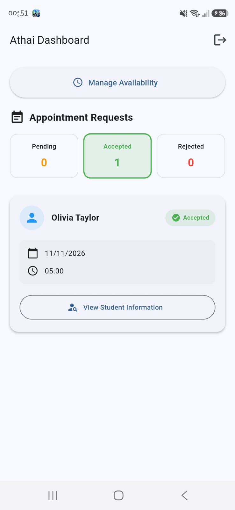 | **Faculty Weekly Availability & Confirmed Schedules** (`teacher_availability.dart`, `teacher_home.dart`) — Weekly consultation slot configurator and approved appointments manager. |
| 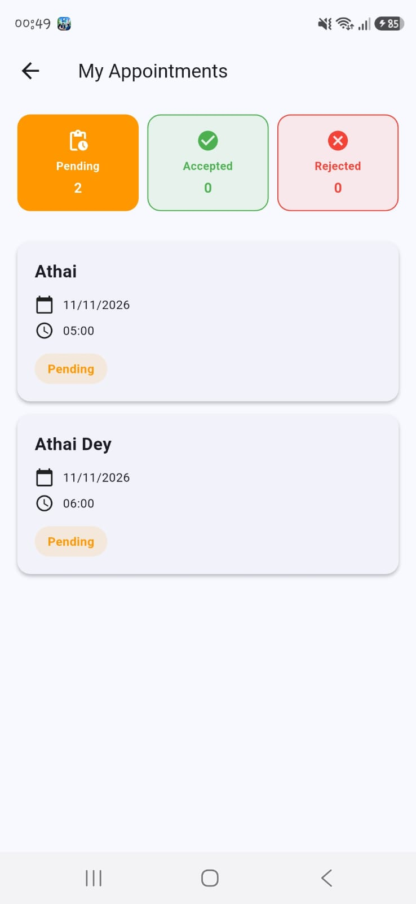 | 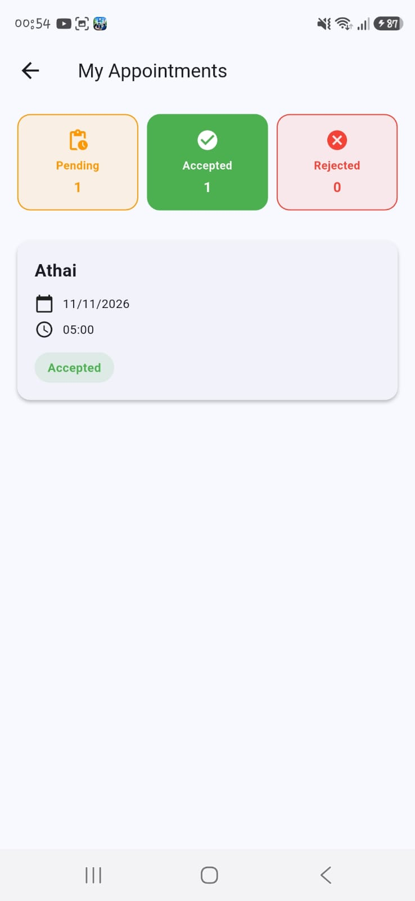 | **Student Appointment Lifecycle Tracker** (`my_appointments.dart`) — Real-time reactive status monitoring transitioning appointments from Pending to Accepted with badge updates. |
| 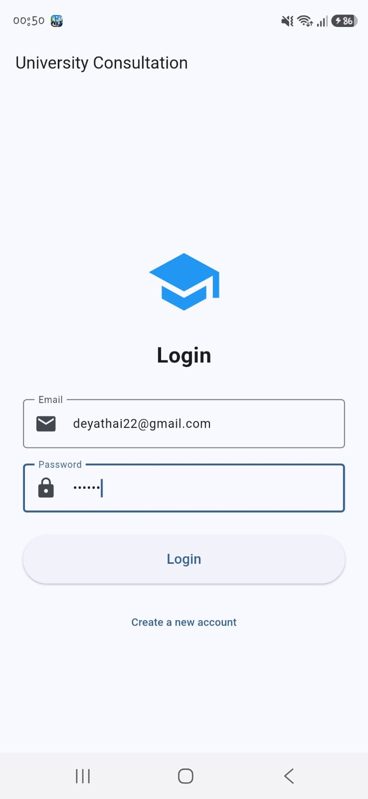 | 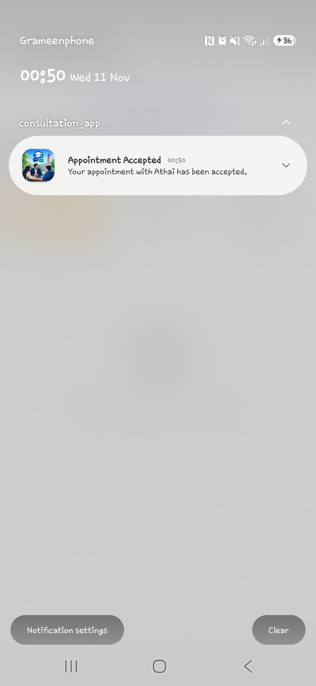 | **Faculty Login & Acceptance Push Notification** — Dedicated teacher sign-in portal and real-time push alert notifying student of consultation acceptance. |

---

## 📊 System Documentation & Academic Analyses

### 1. Feature Comparison Across Existing Solutions

The table below contrasts **ConsultWise** with commercial appointment tools, enterprise calendars, and manual communication methods:

| Feature / Metric | Calendly | Google Calendar | Institutional ERP | Ad-Hoc Email | ConsultWise (This Project) |
|---|:---:|:---:|:---:|:---:|:---:|
| **Platform Target** | Web / Mobile Hybrid | Web & Mobile Apps | Legacy Desktop Web | Email Clients | **Flutter Native Mobile (Android/iOS)** |
| **Cost & Licensing** | Paid (\$12+/mo/seat) | Paid Workspace Tier | High Enterprise IT | Free | **100% Free & Open-Source** |
| **Dedicated Dual Portals** | No (Single User) | No | Single Cluttered View| None | **Dedicated Student & Faculty Dashboards** |
| **Availability Setting** | Complex Rule Builder| Manual Free/Busy | Fixed Term Timetable | None | **Interactive 7-Day Visual TimePicker** |
| **Double-Booking Check** | Cloud Engine | Calendar Sync | Partial | None | **Deterministic Firestore Query Logic** |
| **Push Alerts (Mobile)** | Email / SMS (Paid) | Native Push | Rare | Email Ping | **Native FCM + Local Notifications** |
| **University Metadata** | None | None | Student ID Only | None | **Roll, Series, Dept, Academic Rank** |
| **Approval Workflow** | Auto-Book Only | Auto-Book Only | Manual Admin Review| Email Ping-Pong | **One-Tap Faculty Triage (Approve/Reject)** |

---

### 2. Gap Analysis and Solutions Matrix

| Identified Market Gap | Root Cause in Existing Solutions | Technical Solution Implemented in ConsultWise |
|---|---|---|
| **Office Door Queues & Collisions** | Uncoordinated physical drop-ins without slot reservations | Atomic pre-booking query preventing duplicate bookings for the same teacher and slot |
| **Lack of Faculty Availability Transparency** | Students cannot see whether a professor has office hours today | Dedicated weekly availability configurator displayed on the teacher's profile |
| **Communication Delay (3–5 Days)** | Formal email chains required to negotiate mutually open times | Real-time booking pipeline with instant single-tap faculty approval |
| **Absence of Student Academic Context** | Commercial schedulers lack university roll/department metadata | Built-in student identity registration capturing roll, series, and department |
| **Expensive Licensing Barriers** | Enterprise tools charge per-seat monthly fees prohibitive for students | 100% Free and Open-Source operating within Firebase's free Spark tier |

---

### 3. Technology Stack Justification

| Technology / Tool | Version | Category | Technical Justification |
|---|:---:|---|---|
| **Flutter** | 3.x | Cross-Platform Framework | Ahead-of-Time (AOT) compilation to native ARM machine code, ensuring 60 FPS performance and unified Android/iOS codebase. |
| **Dart** | 3.x | Core Programming Language | Strong type safety, sound null safety, and fast asynchronous programming primitives (`async`/`await`, `Streams`). |
| **Provider** | 6.1.5 | State Management | Decoupled MVVM reactive state pattern with `ChangeNotifier` and `Consumer`, minimizing unnecessary widget rebuilds. |
| **Firebase Auth** | 6.7.0 | Authentication Engine | Secure cryptographic token authentication, session persistence, and role-based credential management. |
| **Cloud Firestore** | 6.10.0 | Cloud NoSQL Database | Real-time document-collection listeners, serverless auto-scaling, and structured hierarchical indexing. |
| **Firebase Messaging (FCM)** | 16.7.0 | Push Notification Engine | Low-latency, battery-optimized push alert delivery dispatching appointment notifications directly to target device tokens. |
| **Flutter Local Notifications** | 22.3.1 | Device Notification Daemon | Handles operating system notification display, heads-up banners, and custom Android notification channels. |
| **Git & GitHub** | - | Version Control & CI | Atomic commit tracking, feature branching, and collaborative peer code review. |

---

## 🏗️ System Architecture & Design Patterns

ConsultWise is built upon a multi-tier layered architecture incorporating the **Model-View-ViewModel (MVVM)** and **Provider** reactive patterns.

### 5-Tier Layered Architecture Diagram

```
┌────────────────────────────────────────────────────────────────────────────────────────┐
│  1. PRESENTATION LAYER (Flutter Material 3 Widgets)                                    │
│     ├── LoginScreen               ├── StudentHome            ├── TeacherHome           │
│     ├── TeacherSearch             ├── TeacherProfile         ├── BookAppointment       │
│     ├── MyAppointments            └── TeacherAvailability                              │
└───────────────────────────────────────────┬────────────────────────────────────────────┘
                                            │ Dispatches Actions & Listens to State
                                            ▼
┌────────────────────────────────────────────────────────────────────────────────────────┐
│  2. STATE & PROVIDER LAYER (ChangeNotifier ViewModels)                                 │
│     ├── AuthProvider              (Registration, login, RBAC, FCM token management)    │
│     ├── TeacherProvider           (Directory caching, in-memory multi-attribute search)│
│     └── AppointmentProvider       (Conflict detection algorithm, booking, status triage│
└───────────────────────────────────────────┬────────────────────────────────────────────┘
                                            │ Encapsulates Domain Entities
                                            ▼
┌────────────────────────────────────────────────────────────────────────────────────────┐
│  3. DOMAIN MODEL LAYER (Dart Plain Objects)                                            │
│     ├── UserModel                 (uid, name, email, role, roll, series, department)   │
│     ├── TeacherModel              (id, name, department, position, email)              │
│     └── AppointmentModel          (id, studentId, teacherId, date, time, status)       │
└───────────────────────────────────────────┬────────────────────────────────────────────┘
                                            │ Asynchronous Cloud Queries / Streams
                                            ▼
┌────────────────────────────────────────────────────────────────────────────────────────┐
│  4. CLOUD BACKEND LAYER (Google Firebase BaaS)                                         │
│     ├── Firebase Authentication   (Managed token auth & encrypted credential storage)  │
│     ├── Cloud Firestore NoSQL     (Real-time document collections & subcollections)    │
│     └── Firebase Cloud Messaging  (Push notifications to target hardware devices)      │
└───────────────────────────────────────────┬────────────────────────────────────────────┘
                                            │ Dispatches Low-Latency Native Alerts
                                            ▼
┌────────────────────────────────────────────────────────────────────────────────────────┐
│  5. OPERATING SYSTEM HARDWARE SERVICES                                                 │
│     ├── Android Notification Channel (High-importance channel: appointment_notifs)     │
│     └── Apple Push Notification Service (APNs)                                         │
└────────────────────────────────────────────────────────────────────────────────────────┘
```

### Annotated Project Directory Tree

```
consultation_system/
├── pubspec.yaml                                 # Flutter project dependencies (Provider, Firebase, etc.)
├── pubspec.lock                                 # Exact dependency lockfile
├── analysis_options.yaml                        # Static analysis & linter rules (flutter_lints)
├── firebase.json                                # Firebase CLI project binding configuration
├── .firebaserc                                  # Firebase active project identifier
├── README.md                                    # Comprehensive project documentation
├── functions/                                   # Firebase Cloud Functions (Node.js backend)
│   ├── index.js                                 # Serverless notification triggers & endpoints
│   └── package.json                             # Cloud functions dependencies
├── android/                                     # Android native wrapper & build configurations
│   └── app/google-services.json                 # Firebase Android configuration file
├── ios/                                         # iOS native configuration & Podfile
└── lib/
    ├── main.dart                                # Application root, FCM handlers & Provider providers
    ├── firebase_options.dart                    # Auto-generated Firebase client credentials
    ├── Models/
    │   ├── user_model.dart                      # User entity (name, email, role, roll, department)
    │   ├── teacher_model.dart                   # Teacher profile entity (name, dept, rank, email)
    │   └── appointment_model.dart               # Appointment entity (parties, slot, time, status)
    ├── Providers/
    │   ├── auth_provider.dart                   # Auth, RBAC logic & FCM token syncing
    │   ├── teacher_provider.dart                # Directory fetching & live search filtering
    │   └── appointment_provider.dart            # Slot conflict checking & booking pipeline
    └── Screens/
        ├── login_screen.dart                    # Sign In with email & password
        ├── register_screen.dart                 # Dual-role registration with student fields
        ├── student_home.dart                    # Student dashboard & navigation hub
        ├── teacher_home.dart                    # Faculty dashboard & request triage portal
        ├── teacher_search.dart                  # Instant faculty search & department filter
        ├── teacher_profile.dart                 # Faculty credentials & "Book Appointment" CTA
        ├── book_appointment.dart               # Date/time slot booking with collision check
        ├── my_appointments.dart                # Student consultation history with status badges
        └── teacher_availability.dart           # Weekly consultation hours configurator
```

---

## 💾 Database Schema & Normalization

The database schema is implemented in **Google Cloud Firestore NoSQL** structured into three primary collections and one nested subcollection:

```
  [ users ]                       [ teachers ]
  - uid (PK)                      - id (PK)
  - name                          - name
  - email                         - department
  - role                          - position
  - roll                          - email
  - series                               |
  - department                           +--- [ availability ] (Subcollection)
  - fcmToken                                  - day (e.g. Monday)
  - createdAt                                 - startTime (e.g. 10:00 AM)
                                              - endTime (e.g. 12:00 PM)

  [ appointments ]
  - id (PK)
  - studentId
  - teacherId
  - studentName
  - teacherName
  - date (YYYY-MM-DD)
  - time (HH:MM AM/PM)
  - status (Pending | Approved | Rejected | Completed)
  - notificationStatus
  - createdAt
```

| Collection | Field | Type | Constraints | Description |
|---|---|:---:|:---:|---|
| `users` | `uid` | String | PRIMARY KEY | Firebase Auth unique user identifier |
| `users` | `name` | String | NOT NULL | User's full legal name |
| `users` | `email` | String | UNIQUE NOT NULL | Academic or personal email address |
| `users` | `role` | String | 'student' \| 'teacher' | Determines interface and access permissions |
| `users` | `roll` | String | Student Specific | University student roll number (e.g., 2403170) |
| `users` | `series` | String | Student Specific | Academic admission series (e.g., 24) |
| `users` | `department` | String | NOT NULL | Academic department (e.g., CSE, EEE, ME) |
| `users` | `fcmToken` | String | Device Token | Push notification hardware device address |
| `users` | `createdAt` | Timestamp | ServerTimestamp | Registration timestamp |
| `teachers` | `id` | String | PRIMARY KEY | Unique faculty document ID |
| `teachers` | `name` | String | NOT NULL | Faculty member's full name |
| `teachers` | `department` | String | NOT NULL | Department affiliation |
| `teachers` | `position` | String | NOT NULL | Academic rank (e.g., Professor) |
| `teachers` | `email` | String | UNIQUE NOT NULL | Official university email |
| `availability` *(Sub)* | `day` | String | Monday–Sunday | Day of the week for consultation office hours |
| `availability` *(Sub)* | `startTime` | String | Valid Time | Opening consultation hour |
| `availability` *(Sub)* | `endTime` | String | Valid Time | Closing consultation hour |
| `appointments` | `id` | String | PRIMARY KEY | Auto-generated unique consultation ID |
| `appointments` | `studentId` | String | Foreign Key | References `users.uid` |
| `appointments` | `teacherId` | String | Foreign Key | References `teachers.id` |
| `appointments` | `studentName`| String | NOT NULL | Full name of requesting student |
| `appointments` | `teacherName`| String | NOT NULL | Full name of faculty member |
| `appointments` | `date` | String | ISO YYYY-MM-DD | Scheduled consultation date |
| `appointments` | `time` | String | Formatted Time | Consultation time slot (e.g., 10:30 AM) |
| `appointments` | `status` | String | DEFAULT 'Pending' | `Pending` \| `Approved` \| `Rejected` \| `Completed` |

---

## 👥 Team Structure & Roles

**Course:** CSE 2100 - Software Development Project I  
**Institution:** Department of Computer Science & Engineering, Rajshahi University of Engineering & Technology (RUET)  
**Supervisor:** **Prof. Dr. Boshir Ahmed**, Professor, Dept. of CSE, RUET  

### Workload Allocation Matrix

| Team Member | Academic Roll | Primary Engineering Deliverables |
|---|:---:|---|
| **Esika Tanzum Yame** | **2403170** *(Section C)* | • Project scaffolding, Flutter environment configuration & dependencies.<br>• Firebase Authentication, role management & RBAC (`AuthProvider`).<br>• Core appointment booking engine & conflict detection algorithm (`AppointmentProvider`, `book_appointment.dart`).<br>• FCM background/foreground push notification setup (`main.dart`).<br>• Teacher schedule triage & appointment action controllers (`teacher_home.dart`). |
| **Athai Dey** | **2403131** *(Section C)* | • UI screen prototyping, Material 3 theme styling & responsive widget layouts.<br>• Faculty directory list, dynamic search bar & filtering logic (`teacher_provider.dart`, `teacher_search.dart`).<br>• Faculty weekly availability configuration interface (`teacher_availability.dart`).<br>• Student appointment tracking dashboard & status badges (`my_appointments.dart`).<br>• Quality assurance testing, test scenarios & documentation. |

---

## 🚀 Installation & Setup Guide

### Prerequisites

Ensure you have the following tools installed on your development workstation:
- **Flutter SDK (v3.12+ or latest 3.x)** ([Install Flutter](https://docs.flutter.dev/get-started/install))
- **Dart SDK (v3.x)** (bundled with Flutter)
- **Android Studio** or **Visual Studio Code** (with Flutter & Dart extensions)
- An active **Android Emulator** or physical device with Developer Mode / USB Debugging enabled

### Step-by-Step Installation

1. **Clone the repository:**
   ```bash
   git clone https://github.com/Yame-18/ConsultWise.git
   cd ConsultWise
   ```

2. **Install Flutter package dependencies:**
   ```bash
   flutter pub get
   ```

3. **Verify Flutter environment health:**
   ```bash
   flutter doctor
   ```

4. **Launch the application:**
   ```bash
   flutter run
   ```

### Firebase Configuration

If you are connecting your own Firebase backend:
1. Create a project in the [Firebase Console](https://console.firebase.google.com/).
2. Enable **Firebase Authentication** (Email/Password provider).
3. Enable **Cloud Firestore** in test or production mode.
4. Download your `google-services.json` and place it in `android/app/google-services.json`.
5. Run `flutterfire configure` to generate updated `lib/firebase_options.dart`.

---

## 🧪 Quality Assurance & Testing

Automated test cases validate conflict detection logic and state transitions independently of the UI:

```bash
flutter test
```

### Key Verified Test Scenarios

- **TC-01 (Role-Based Registration)**: Verifies student account creation, role assignment, and metadata persistence in Firestore. (Status: **PASS**)
- **TC-02 (Slot Collision Prevention)**: Confirms that attempting to book an already occupied slot triggers the conflict exception and halts database writes. (Status: **PASS**)
- **TC-03 (Teacher Status Triage)**: Confirms that approving an appointment transitions status to `Approved` and triggers reactive UI updates. (Status: **PASS**)

---

## 🔮 Future Scope & Roadmap

- 📹 **In-App Video Consultations (WebRTC)**: Embed direct peer-to-peer video calling for remote advisement during semester recesses.
- 🔄 **Google Calendar Two-Way Sync**: Synchronize approved appointments automatically into the professor's official Google Calendar.
- 🤖 **AI-Powered Meeting Summarizer**: Incorporate an LLM voice/text memo tool to transcribe and summarize post-consultation action items for students.
- 📎 **Thesis & Code Attachment Pipeline**: Allow students to attach PDF project proposals or code snippets directly to appointment requests for preliminary faculty review.

---

## 📄 License & Institutional Context

Distributed under the **MIT License**. See the standalone [`LICENSE`](LICENSE) file for complete terms and copyright notices.

Developed for academic evaluation in **CSE 2100 - Software Development Project I** at the **Department of Computer Science & Engineering, Rajshahi University of Engineering & Technology (RUET)**.
